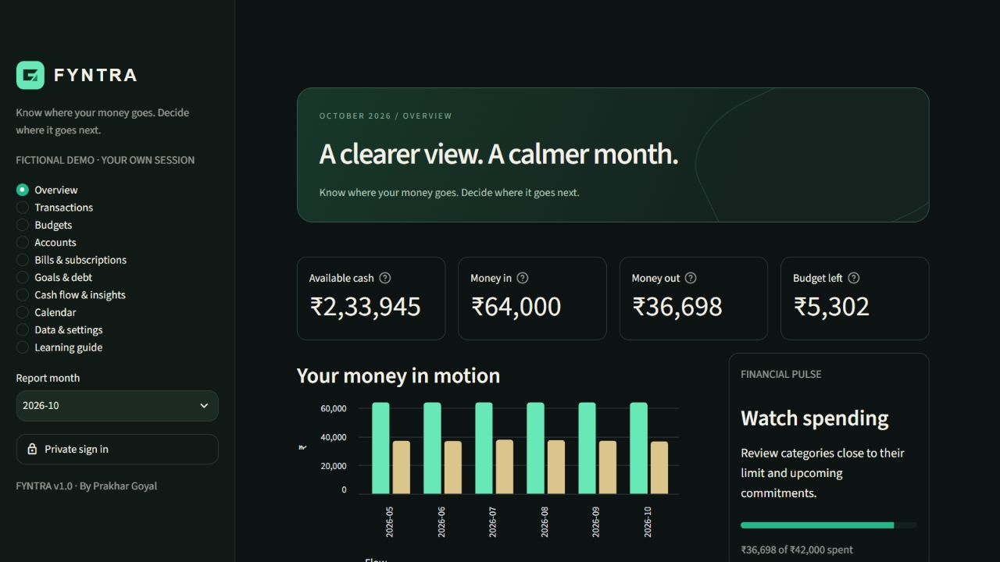

# FYNTRA


**Know where your money goes. Decide where it goes next.**

FYNTRA is a personal finance workspace built by **Prakhar Goyal** with Python, NumPy, Pandas, SQLite and Streamlit. It brings accounts, transactions, budgets, commitments, goals, debt and financial insights into one workspace.

[](https://fyntra-prakhargoyal.streamlit.app)

**[Launch the fictional demo](https://fyntra-prakhargoyal.streamlit.app)** · [Explore the source](https://github.com/prakhargoyal02/FYNTRA)

## Features

- **Overview:** available cash, income, expenses, budget remaining, Financial Pulse, upcoming commitments, savings and net worth.
- **Transactions:** create, edit, duplicate and delete; search merchant, notes, category, tags and amounts; filter dates, accounts, categories, payment methods, types and amounts.
- **Accounts:** bank, cash, savings, cards, wallets, investments and custom sources. Transfers change account balances without becoming income or spending.
- **Budgets:** monthly category limits, utilization, remaining amounts, status bands, total spending limit and an affordability calculator.
- **Bills & subscriptions:** recurring commitments with ledger-linked payments and safe next-date advancement.
- **Goals & debt:** savings allocations, goal progress, principal/interest payments and reversible linked payments.
- **Insights:** category breakdowns, daily and monthly spending, trailing averages, cash flow, savings, account distribution, subscription cost and recorded net-worth history.
- **Planning:** monthly review, calendar timeline and duplicate-safe recurring entry generation.
- **Portability:** individual CSVs and full FYNTRA Bundle export/import with preview, validation and deduplication.
- **Public demo:** deterministic fictional data in a separate temporary database for each browser session.
- **Private workspace:** optional Supabase authentication, Row Level Security and cloud synchronization.

## Preview



The screenshots and demo figures are fictional. Validation notes are available in [docs/VALIDATION.md](docs/VALIDATION.md).

## Tech stack

| Technology | Role |
| --- | --- |
| Python | application logic, validation and domain operations |
| NumPy | numerical finance calculations and vectorized summaries |
| Pandas | transaction processing, grouping, filtering and analytics |
| SQLite | structured local ledger and relationships |
| Streamlit | interactive web interface |
| Supabase | optional private authentication and synchronized cloud state |

## Architecture


| File | Responsibility |
| --- | --- |
| `app.py`, `views.py`, `ui.py` | navigation, forms, charts and presentation |
| `database.py` | schema, validation and atomic financial operations |
| `analytics.py` | financial summaries, projections and reporting |
| `csv_tools.py` | validated import/export and backup portability |
| `demo_data.py` | deterministic fictional sample ledger |
| `cloud_sync.py`, `auth_ui.py` | optional authentication and cloud synchronization |
| `tests/` | finance, interface and cloud-boundary regression checks |

## Run locally

Use Python 3.12 or 3.13.

```sh
python -m venv .venv
# Windows PowerShell
.venv\Scripts\Activate.ps1
# macOS / Linux
# source .venv/bin/activate
python -m pip install -r requirements.txt
python -m streamlit run app.py
```

For development checks:

```sh
python -m pip install -r requirements-dev.txt
python -m pytest -q
```

No credentials are required for the fictional demo. Never enter bank passwords, card numbers, CVVs, PINs or OTPs.

## Financial conventions

Money is stored as **integer paise**. The interface defaults to INR and Indian number grouping. Transfers are neutral to income and spending. Credit card balances are treated as amounts owed. Goal contributions earmark existing money rather than creating income or extra assets.

Savings rate is net cash flow divided by income; zero-income periods display no rate. Forecasts are arithmetic scenarios based on recorded data, not financial advice.

## Privacy

No personal financial data is stored in this repository. Public visitors receive fictional demo data only. Private SQLite working files are temporary and session-specific. Optional cloud synchronization uses Supabase authentication, ownership policies and revision checks.

Secrets, database files, environment files and private uploads are excluded from version control. See [deployment instructions](docs/DEPLOYMENT.md) and [security notes](docs/SECURITY.md).

## Author

**Prakhar Goyal** · [GitHub](https://github.com/prakhargoyal02) · [LinkedIn](https://www.linkedin.com/in/prakhar-goyal-d2002/)
