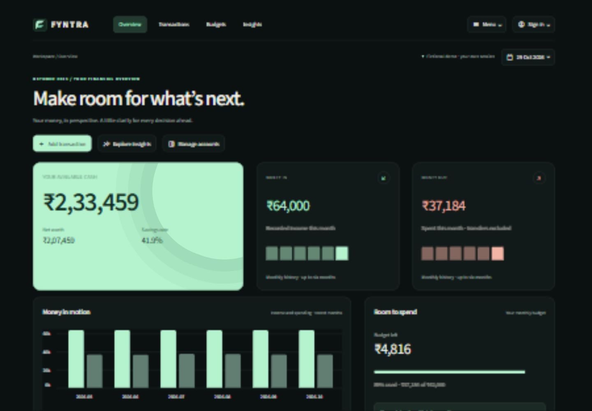
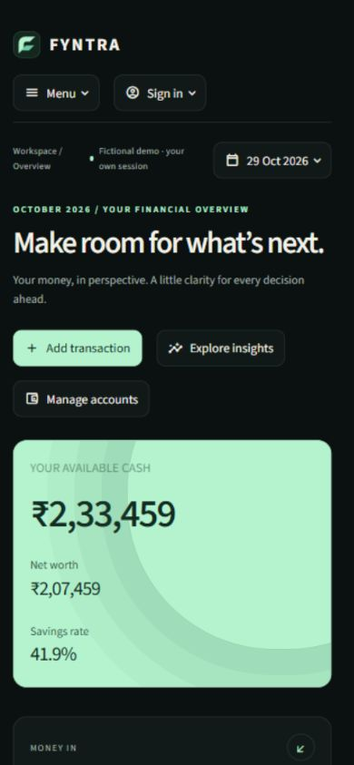
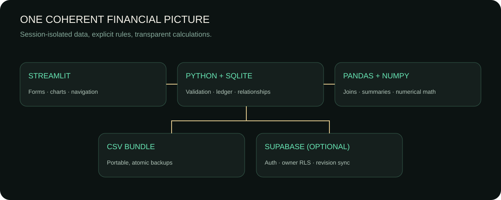

<div align="center">


<br />

<a href="https://fyntra-prakhargoyal-0003.streamlit.app"></a>
<a href="https://github.com/prakhargoyal02/FYNTRA/actions"></a>
<a href="https://github.com/prakhargoyal02/FYNTRA"></a>

### Know where your money goes. Decide where it goes next.

**FYNTRA** is a personal-finance workspace built with Python, NumPy, Pandas, SQLite, Streamlit and Supabase. It combines everyday money tracking, financial analytics and bank-statement review in one portfolio-ready application.

[Live App](https://fyntra-prakhargoyal-0003.streamlit.app) · [Source](https://github.com/prakhargoyal02/FYNTRA) · [LinkedIn](https://www.linkedin.com/in/prakhar-goyal-d2002/)

</div>

---

## ✦ What FYNTRA does

FYNTRA is designed around a simple idea: **your ledger should stay understandable even when the product becomes powerful**.

| Area | What it handles |
| --- | --- |
| 🧭 **Overview** | Available cash, money in/out, budget position, financial pulse, goals, debt and upcoming commitments |
| 💸 **Transactions** | Income, expenses, transfers, search, filters, duplicate/edit/delete and recurring schedules |
| 🏦 **Accounts** | Bank, cash, savings, wallet, card, investment and custom account types |
| 🎯 **Budgets** | Monthly category limits, utilization, remaining budget and spending pressure |
| 🧾 **Bills & subscriptions** | Recurring commitments, renewal dates and ledger-linked payment records |
| 🌱 **Goals & debt** | Savings targets, contributions, debt balances, principal and interest payments |
| 📈 **Cash flow & insights** | Category analysis, daily trends, rolling averages, monthly cash flow and net worth |
| 🗓️ **Calendar** | Upcoming bills, subscriptions, recurring movements, debt dates and goal milestones |
| 📂 **Bank statements** | CSV, XLSX, PDF, TXT and screenshot review with optional import into the FYNTRA ledger |
| 🔐 **Private workspace** | Optional Supabase authentication, Row Level Security and cloud persistence |

---

## 🖥️ Current interface

<div align="center">
  
  
</div>

<p align="center"><sub>Current FYNTRA interface with fictional demo data.</sub></p>

The public demo is deliberately isolated from private data. Each public browser session receives fictional sample records and can explore the application without credentials.

---

## ⚡ The finance engine

FYNTRA is not just a styled dashboard. The important work happens underneath the interface.

### Money stays precise

All stored monetary values use **integer paise**, not floating-point currency values. Conversion to rupees happens at the presentation and analytics layers.

```text
₹1,249.50
   ↓
124950 paise
   ↓
SQLite / validation / calculations
   ↓
₹1,249.50 in the interface
```

### Transfers stay neutral

A transfer changes two account balances but is **not counted as income or spending**. This prevents internal money movement from inflating cash-flow reports.

### Linked payments stay reversible

Bills, subscriptions, recurring entries and debt payments can create linked ledger transactions. Their source relationship is preserved so supported payment actions can be safely undone instead of leaving disconnected records behind.

### Historical reporting uses a real cutoff

The report-date control changes the effective analytics date, letting FYNTRA calculate balances and monthly views from a historical point instead of always assuming today.

---

## 🏦 Bank statement workflow

One of the larger FYNTRA workflows turns external statement files into reviewable ledger data without silently changing the user's accounts.

```text
Bank statement
     │
     ├── CSV / XLSX
     ├── PDF / TXT
     └── PNG / JPG / WEBP
     │
     ▼
Extract + normalize rows
     │
     ▼
Review dates, amounts, direction,
category, payment method and balance
     │
     ├── Save for analysis only
     │
     ├── Import into an existing account
     │
     └── Create an account from the statement
             │
             ▼
      Duplicate-safe ledger import
```

### Statement safety choices

- Uploading a statement does **not** automatically modify Transactions.
- Reviewed statements can remain saved only for analysis and comparison.
- Imported rows carry statement-specific source keys for duplicate protection and cleanup.
- One, selected, or all saved statements can be imported into a chosen account.
- Statement imports can be removed while keeping the saved analysis.
- Complete deletion can remove both the imported ledger rows and the saved statement.
- Orphaned statement-import transactions can be detected and cleaned safely.

---

## 📊 Pandas + NumPy in the project

FYNTRA uses the data stack for real application work rather than adding libraries only for the technology list.

**Pandas** handles transaction frames, filtering, joins, monthly grouping, category summaries, pivots, sorting, statement normalization and comparison tables.

**NumPy** handles vectorized financial arithmetic including savings rates, budget utilization, cash-flow differences, rolling values, balance calculations and guarded divide-by-zero behavior.

A few examples from the analytics layer:

```python
net = np.subtract(income, expenses)

rate = np.divide(
    net * 100,
    income,
    out=np.full_like(net, np.nan),
    where=income != 0,
)
```

---

## 🧱 Architecture

<div align="center">
  
</div>

| Layer | Main responsibility |
| --- | --- |
| `app.py` | Application bootstrap, navigation, historical report state and data scope |
| `database.py` | SQLite schema, validation, relationships and financial operations |
| `analytics.py` | Pandas/NumPy reporting and finance calculations |
| `views.py` | Shared Streamlit workflows and safe save/delete helpers |
| `modern_*`, workspace modules | Current interface screens and focused page workflows |
| `statement_tools.py` | Statement extraction, normalization and transaction classification |
| `statement_flow.py` | Shared statement metadata, selection and ledger-import logic |
| `statement_upload.py` | Upload, review and account-import experience |
| `statement_manage.py` | Statement cleanup, import removal and orphan recovery |
| `csv_tools.py` | FYNTRA backup import/export and validation |
| `auth_ui.py`, `cloud_sync.py` | Optional private authentication and synchronized state |
| `tests/` | Finance, interface, cloud and regression coverage |

---

## 🧰 Tech stack

<div align="center">


</div>

---

## 🧪 Tested from finance rules to interface flows

The repository ships with automated regression tests and a GitHub Actions matrix for **Python 3.12 and 3.13**.

Current regression suite: **42 passing tests**.

Coverage includes:

- money conversion and financial validation
- account balances and transfer neutrality
- budgets and analytics edge cases
- bill and subscription payment flows
- savings goals and debt payments
- CSV backup round trips and deduplication
- session isolation
- cloud serialization boundaries
- bank-statement parsing and import behavior
- orphaned statement-import cleanup
- historical report dates
- single-click sidebar/date/statement state behavior
- Streamlit navigation and transaction CRUD
- empty-workspace rendering

```bash
python -m pytest -q
```

The latest validation notes live in [`docs/VALIDATION.md`](docs/VALIDATION.md).

---

## 🚀 Run FYNTRA locally

### Windows quick start

FYNTRA includes a Windows launcher and VS Code configuration.

```powershell
py -3.13 tools/manage.py setup
.venv\Scripts\python.exe tools/manage.py run
```

Or double-click:

```text
START_FYNTRA.cmd
```

### Standard Python setup

```bash
git clone https://github.com/prakhargoyal02/FYNTRA.git
cd FYNTRA
python -m venv .venv
```

Windows PowerShell:

```powershell
.venv\Scripts\Activate.ps1
python -m pip install -r requirements.txt
python -m streamlit run app.py
```

macOS / Linux:

```bash
source .venv/bin/activate
python -m pip install -r requirements.txt
python -m streamlit run app.py
```

Open `http://localhost:8501`.

For the full local setup, diagnostics and debugger workflow, see [`START_HERE.md`](START_HERE.md).

---

## 🔐 Demo mode vs private mode

### Public demo

No account or database setup is required. FYNTRA creates an isolated temporary SQLite workspace filled with fictional sample data.

### Private mode

Private mode can use Supabase for authentication and cloud persistence. The supplied schema creates:

- `fyntra_state` for the synchronized FYNTRA state bundle
- `fyntra_statements` for saved bank-statement analysis

Both tables use **Row Level Security** and ownership policies tied to the authenticated user.

Configuration details are in [`docs/DEPLOYMENT.md`](docs/DEPLOYMENT.md) and [`docs/SECURITY.md`](docs/SECURITY.md).

> Never place service-role keys, bank passwords, card numbers, PINs, CVVs or OTPs inside the repository or a FYNTRA statement upload.

---

## 🗂️ Project structure

<details>
<summary><strong>Open repository map</strong></summary>

```text
FYNTRA/
├── app.py                     # application entry point
├── database.py                # SQLite schema + finance operations
├── analytics.py               # Pandas / NumPy analytics
├── views.py                   # shared Streamlit workflows
├── modern_overview.py         # current dashboard
├── modern_transactions.py     # transaction workspace
├── premium_analytics.py       # insights workspace
├── account_workspace.py       # account management
├── calendar_view.py           # stable timeline controls
├── data_settings.py           # backup/settings workspace
├── statement_tools.py         # parsing + normalization
├── statement_flow.py          # shared statement import logic
├── statement_upload.py        # upload/review flow
├── statement_manage.py        # cleanup flow
├── statement_workspace.py     # statement navigation
├── statements.py              # saved statement persistence helpers
├── csv_tools.py               # FYNTRA backup portability
├── auth_ui.py                 # optional private sign-in
├── cloud_sync.py              # Supabase state synchronization
├── demo_data.py               # deterministic fictional demo
├── supabase_schema.sql        # private-mode schema + RLS
├── assets/                    # brand, screenshots and UI assets
├── docs/                      # deployment, security and validation
└── tests/                     # automated regression suite
```

</details>

---

## ✨ Design principles

FYNTRA's current interface follows a few simple rules:

- information first, decoration second
- strong hierarchy without visual noise
- responsive desktop and mobile layouts
- clear distinction between **money movement** and **financial commitments**
- explicit user actions for destructive or history-changing operations
- no silent statement-to-ledger import
- no pretending arithmetic projections are predictions

The visual system uses a dark charcoal base with mint financial accents, compact metric cards, quiet borders and restrained motion.

---

## 📌 Financial conventions

<details>
<summary><strong>Open the accounting assumptions</strong></summary>

- Currency is currently INR.
- Money is stored internally as integer paise.
- Transfers do not count as income or expenses.
- Credit-card account balances can represent amounts owed with negative balances.
- Goal contributions earmark money already owned and do not create new income.
- Standalone debts should not duplicate liabilities already represented by a credit-card account.
- Recurring schedules create entries only when explicitly posted.
- Forecast-style values are arithmetic scenarios built from recorded spending pace.
- Investment balances are manually maintained; market prices are not fetched.

</details>

---

## 🌐 Links

<div align="center">

<a href="https://fyntra-prakhargoyal-0003.streamlit.app"></a>
<a href="https://github.com/prakhargoyal02"></a>
<a href="https://www.linkedin.com/in/prakhar-goyal-d2002/"></a>

</div>

---

## 👨‍💻 Author

<div align="center">

### Prakhar Goyal

**Builder of FYNTRA · Portfolio Project 02**

I built FYNTRA to practice turning Python, data analysis, relational storage and product UI into one complete application instead of isolated exercises.

[GitHub](https://github.com/prakhargoyal02) · [LinkedIn](https://www.linkedin.com/in/prakhar-goyal-d2002/) · [Launch FYNTRA](https://fyntra-prakhargoyal-0003.streamlit.app)

<br />


**FYNTRA**  
*Know where your money goes. Decide where it goes next.*

</div>
