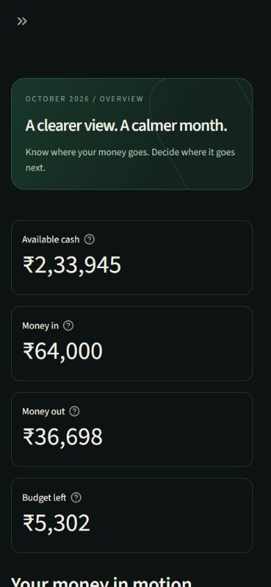

# Validation record

## Automated checks

FYNTRA includes finance, interface and cloud-boundary regression tests covering money conversion, transfer neutrality, budget status boundaries, empty-state analytics, bill and subscription payment safety, debt payment and undo, anchored recurrence, CSV round trips, duplicate handling, rollback, session isolation and transaction CRUD through Streamlit AppTest.

GitHub Actions runs the test suite on Python 3.12 and Python 3.13.

## Browser review

The desktop dashboard and narrow mobile layout were reviewed using fictional demo data. Cards stack on smaller screens, the sidebar collapses, charts follow container width and transaction tables retain internal scrolling where needed.

A startup race involving the authentication component and demo-store initialization was fixed by publishing the seeded demo Store to session state before mounting the authentication bridge.

## Cloud boundary

The FYNTRA cloud table uses Row Level Security. Ownership policies constrain reads, inserts, updates and deletes to the authenticated user ID. Private mode uses a temporary SQLite working copy and a revision guard to prevent silent cloud overwrites.

## Deployment

The public FYNTRA demo is available at https://fyntra-prakhargoyal.streamlit.app. The deployed demo uses fictional data and does not require private cloud credentials.

Automated checks cover the financial and data-processing rules. Browser-level deployment checks should be repeated after dependency, authentication, deployment-coordinate or major interface changes.
